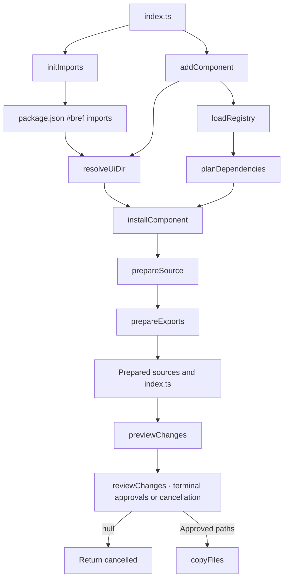

# Component CLI

The Bref CLI is being built to copy editable component source into a consumer project's
configured UI directory, using package types from `bref-ui/types`.

## Overview

The executable routes init and add to the implemented stages and ships in the local package.
`init` adds a `#bref` subpath import to `package.json`; `add` copies into the directory
it maps to. There is no configuration file. The CLI runs on Node.js through npm.
Run commands from the consumer project directory:

```sh
npx bref-ui init
npx bref-ui add button
npx bref-ui add theme
```

Install the local tarball with `npm install /path/to/bref-ui-<version>.tgz`. The executable loads
the canonical registry shipped in the package; copied components use its `bref-ui/types`
entry. `add theme` copies a separate default-only Theme; edit its CSS tokens directly. The package Theme accepts a palette prop. Use `npx bref-ui --help` for usage. Direct source invocation remains available
with `node /path/to/bref-ui/dist-cli/index.js <command>` after packing.

`npm pack` from `core/` validates manifests through `loadRegistry`,
builds the library and runs publint before producing a local tarball. The package ships
compiled CLI JavaScript modules and canonical `src/lib` sources alongside `dist`. Import/export
parsing reuses `svelte/compiler`; the TypeScript compiler remains development-only and
is not installed for CLI consumers. Packing does not publish to npm.

Packing copies the repository README and license into `core/` so npm includes them.
These generated copies are ignored; edit the root originals.

Run `bun run --cwd core test` from the workspace root for Vitest executable contracts.
The suite packs and installs the local package into a temporary npm consumer, then runs
`npx --no -- bref-ui` offline against isolated projects. It covers initialization, copying,
dependency files, repeat runs, invalid arguments and cancellation/overwrite approvals.
Initial npm installation may download package dependencies; temporary files are cleaned up.



## Workflow documentation

| Directory                                | Workflows                                                | Status      |
| ---------------------------------------- | -------------------------------------------------------- | ----------- |
| [config](config/README.md)               | Read import aliases; resolve the UI directory            | Implemented |
| [registry](registry/README.md)           | Plan dependencies                                        | Implemented |
| [registry/load](registry/load/README.md) | Discover and validate manifests and dependencies         | Implemented |
| [installation](installation/README.md)   | Prepare sources and exports; preview changes; copy files | Implemented |
| [installation](installation/README.md)   | Coordinate installation                                  | Implemented |
| [commands](commands/README.md)           | Add components with terminal review                      | Implemented |
| [commands](commands/README.md)           | Initialize imports                                       | Implemented |
| [commands](commands/README.md)           | Route commands                                           | Implemented |

## Source layout

```text
cli/
  index.ts
  pack.ts
  commands/
    index.ts
    execute.ts
    parse.ts
    types.ts
    add/
      index.ts
      approve-overwrites.ts
      display-changes.ts
      review-changes.ts
      utils.ts
    init-imports.ts
  config/
    imports/
      index.ts
      collect-directory-aliases.ts
      read-package-imports.ts
    resolve-ui-dir.ts
  installation/
    index.ts
    copy/
      index.ts
      validate-overwrite-approvals.ts
      write-prepared-files.ts
    exports/
      index.ts
      collect-exports.ts
      create-additions.ts
      merge-content.ts
      read-declared-export-names.ts
      read-exported-names.ts
      read-index.ts
      read-reexported-names.ts
      types.ts
      utils.ts
    parser/
      index.ts
      types.ts
      utils.ts
    prepare/
      index.ts
      collect-source-files.ts
      read-source-files.ts
      rewrite-imports.ts
      rewrite-source.ts
      types.ts
    preview/
      index.ts
      compare-prepared-files.ts
      read-destination-files.ts
      types.ts
    types.ts
  registry/
    load/
      index.ts
      create-registry.ts
      discover-manifests.ts
      load-entry.ts
      utils.ts
      validate-dependencies.ts
    plan/
      index.ts
      collect-entries.ts
    types.ts
  tsconfig.json
```

Single-file stages use named files. Stages with supporting files use a folder whose
`index.ts` is the sole public entry. Each functional module exposes one public function.
An entry file contains only its orchestration function, calling named steps in sibling
files. General helpers live in the stage's `utils.ts`; types stay within their responsibility.
See [CLI contribution rules](AGENTS.md).
