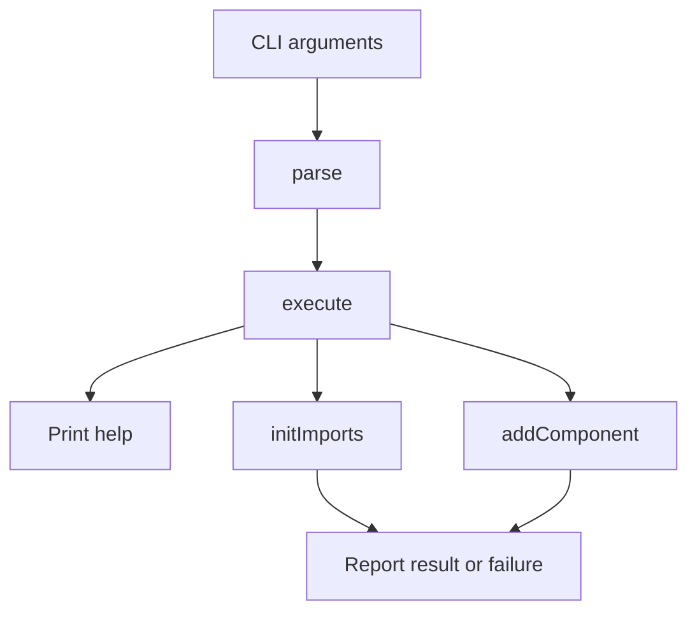
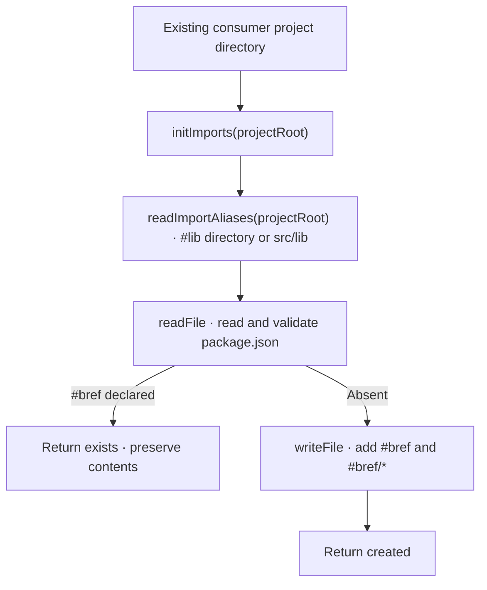
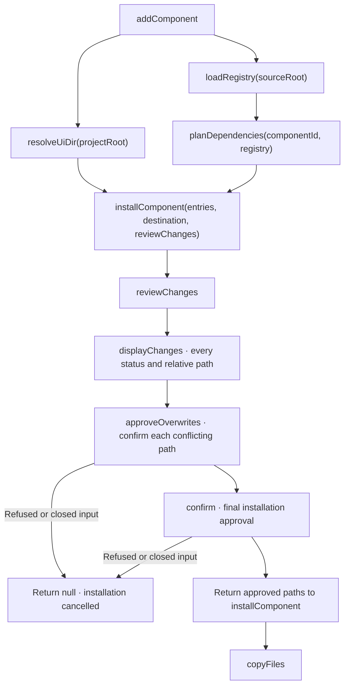

# Commands

[CLI overview](../README.md)

The executable and init/add/docs commands are implemented. Commands use the current directory
as the consumer project; the registry comes from canonical sources beside the executable,
either in the installed package or the source checkout. Node.js runs the compiled executable.

## Route commands

[`cli/index.ts`](../index.ts) calls [`runCommand`](index.ts), the commands directory’s
sole routing entry. It calls `parse`, then `execute`. Its catch block prints a concise
message directly with `console.error` and sets exit code 1.
Help, successful commands and deliberate cancellation exit with code 0.

Supported arguments are `init`, `add <component>`, `docs list`, `docs cli`,
`docs <component> [usage|props|cli]`, `help`, `--help` and `-h`. No arguments
also shows help; `init --help`, `add --help` and `docs --help` are accepted. Unknown commands, unsupported
options, missing component IDs and extra arguments fail before accessing project files.



## Read documentation

`execute` sends docs requests to `readDocumentation` in [documentation](../documentation/README.md).
This branch runs before consumer initialization and installation. It reads only the bundled,
versioned catalogue. Full references are the default; invalid sections, extra arguments and
unknown components fail with an actionable error. Skills are deferred.

## Initialize imports

[`initImports(projectRoot)`](init-imports.ts) adds `"#bref"` and `"#bref/*"` to the
consumer's `package.json` `imports` and returns `created`. They map to a `ui` directory
inside the `#lib/*` target, or to `src/lib/ui` without one:

```json
"imports": {
	"#bref": "./src/lib/ui/index.js",
	"#bref/*": "./src/lib/ui/*"
}
```

When either key is already declared, nothing is changed and `exists` is returned.
The file's indentation and key order are kept. A missing or invalid `package.json`, a
non-object `imports` field and write failures propagate. Reading and writing are separate
operations; concurrent initialization of the same project is unsupported.



## Add a component

[`addComponent`](add/index.ts) connects [configuration](../config/README.md),
[registry loading](../registry/load/README.md), [dependency planning](../registry/README.md)
and [installation](../installation/README.md). It accepts the component ID, consumer
project root and canonical source root, then returns `installed` or `cancelled`.
Errors propagate to the caller.

The consumer's `package.json` must declare `"#bref/*"`; its directory receives the
copied components. Edit that import to change the destination.



Confirmations read one line from standard input. Only `y` or `yes` accepts, ignoring case and
surrounding whitespace. Refusal, empty input or closed input at any prompt cancels
without writes; remaining prompts are skipped. `index.ts` needs its own approval
when its content changes. Accepted copying can fail partially; writes are not atomic.
