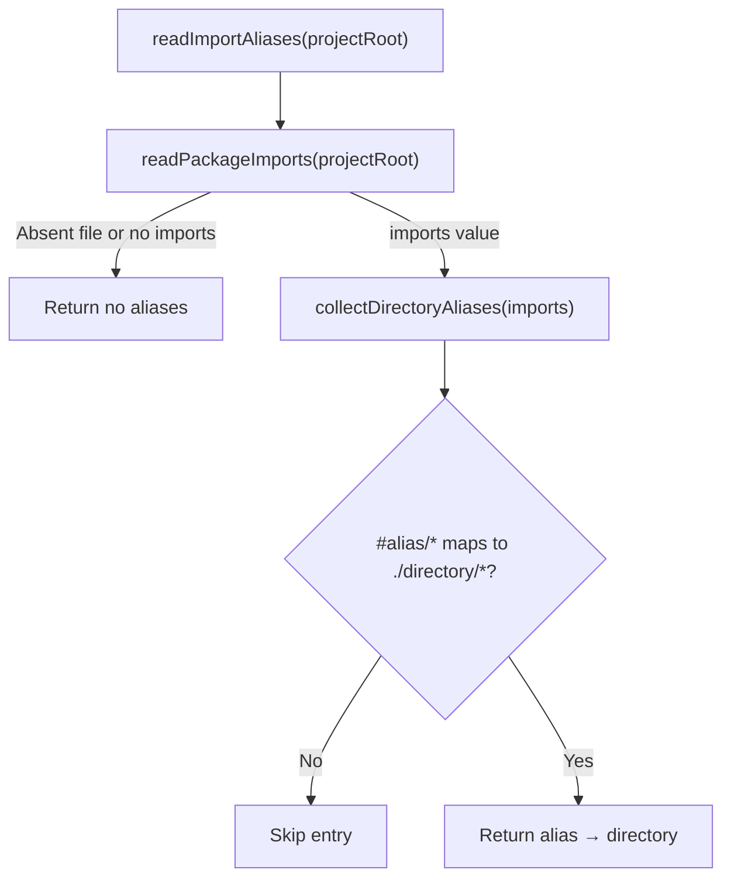
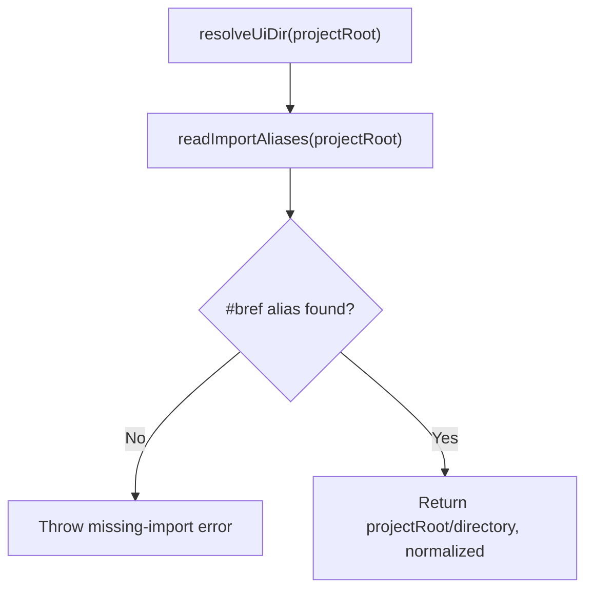

# Configuration

[CLI overview](../README.md)

The CLI has no configuration file. The consumer's `package.json` `imports` field is the
single source of truth: `"#bref/*"` names the directory receiving copied components.

## Read import aliases

[`readImportAliases(projectRoot)`](imports/index.ts) reads `package.json` `imports` and
returns directory aliases without executing project configuration. Only `#` patterns
mapping `/*` to a `./<directory>/*` string, or a conditional object's string `default`,
are returned; `"#bref/*": "./src/lib/ui/*"` becomes `#bref → src/lib/ui`.

A missing `package.json` returns no aliases; unreadable files and invalid JSON reject.
Exact entries such as `"#bref": "./src/lib/ui/index.js"`, suffixed patterns, arrays and
conditions without a string `default` are skipped.

## Resolve the UI directory

[`resolveUiDir(projectRoot)`](resolve-ui-dir.ts) returns the normalized absolute directory
mapped by `"#bref/*"`. A missing or non-directory `"#bref/*"` import is an error that
points to `bref-ui init`.

Import targets cannot reference other `#` imports, so `init` writes a concrete path
inside the project's `#lib/*` directory rather than `#lib/ui`.
