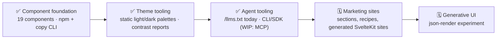

# Bref-ui

A Svelte-first, human-first, agent-first UI library for building beautiful sites
and apps with components you can make your own.

[](https://www.npmjs.com/package/bref-ui)
[](https://discord.gg/JpgQRTUsVS)
[](LICENSE)

The [documentation](https://feuersteiner.github.io/bref-ui/) includes component
playgrounds and the [Todo, House Shop and RunnerAI demos](https://feuersteiner.github.io/bref-ui/demo).
Explore [New Paris, VS Code, Glassy and Crystal Code](https://github.com/feuersteiner/bref-ui/tree/main/themes#readme)
through individual `bref-ui-themes` entry points.

## See Bref-ui in 60 seconds

https://github.com/user-attachments/assets/b2a0cff0-5d34-4f5b-bbdb-0233e0fef81e

Three apps side by side. Import components, customize a theme and copy the source
into your codebase. Then explore New Paris shopping, the ADE workbench with VS Code
styling and a Glassy workspace—all in one minute.

The [Svelte production app and storyboard](https://github.com/feuersteiner/bref-ui/tree/main/video-demo#readme)
include the repeatable video renderer.

## Get started

### 1. Install

In a Svelte 5.56.1+ or SvelteKit project:

```sh
npm install bref-ui
```

### 2. Import

Render `Theme` once in your app root, then use components anywhere:

```svelte
<script lang="ts">
	import { Button, Theme } from 'bref-ui';
</script>

<Theme />
<Button label="Save" />
```

### 3. Customize

Paint native HTML with the same recipe as `Surface` and `Button`:

```svelte
<script>
	import { surface } from 'bref-ui';
</script>

<button class={surface({ variant: 'filled', color: 'primary', shadow: 'small' })}>Save</button>
```

Or own the source: the optional CLI (runs on Node.js) copies components into your project.

```sh
npx bref-ui init
npx bref-ui add button
```

`init` adds a `#bref` import to `package.json`, pointing at `src/lib/ui` by default:

```json
"imports": {
	"#bref": "./src/lib/ui/index.js",
	"#bref/*": "./src/lib/ui/*"
}
```

`add` previews every file and asks before overwriting anything. Import your copies from
`#bref` and keep `bref-ui` installed for its shared types:

```svelte
<script lang="ts">
	import { Button, Theme } from '#bref';
</script>
```

Components: `button`, `checkbox`, `combobox`, `dialog`, `icon`, `pill`,
`pill-choice-group`, `pill-group`, `popover`, `progress`, `select`, `spinner`,
`surface`, `switch`, `tabs`, `text-area`, `text-input`, `theme` and `tree-view`.

## Why Bref-ui?

[Watch the Bref-ui showcase](https://feuersteiner.github.io/bref-ui/#why-bref-ui).

- **Svelte-first.** Strictly Svelte: no runtime dependencies, scoped CSS, native HTML,
  events, bindings and snippets. No class names to memorize.
- **Human-first.** Simple to use, simpler to customize: copy the source and grow it as
  your own.
- **Agent-first.** Typed APIs and an [`/llms.txt`](https://feuersteiner.github.io/bref-ui/llms.txt)
  reference help agents discover, compose and verify interfaces.

## Documentation

Explore the [component gallery](https://feuersteiner.github.io/bref-ui/) for examples,
props and theme customization. Get started with [Use the package](https://feuersteiner.github.io/bref-ui/library),
[Own the code](https://feuersteiner.github.io/bref-ui/cli) and
[Use a prebuilt theme](https://feuersteiner.github.io/bref-ui/themes).

## Repository structure

Install workspace dependencies with Bun, then run commands from the repository root.
Bun is used for workspace development; the published CLI runs through Node.js and npm.

```sh
bun install
bun run dev     # docs from workspace source exports
bun run check   # all package checks
bun run lint
bun run --workspaces --if-present test # CLI contract tests
bun run build   # both libraries and the static docs site
bun run preview # preview docs/build
```

- [`core`](core): the `bref-ui` package, with [components](core/src/lib), the
  [copy CLI](core/cli/README.md).
- [`themes`](themes): New Paris, VS Code, Glassy and Crystal Code, each with its own package entry point.
- [`docs`](docs): the static component documentation, playgrounds, demos and palette previews.
- [`video-demo`](video-demo): the Svelte showcase app, storyboard and repeatable video renderer.

The root lint/format configuration covers every package. The docs site imports public
package source exports directly; no package prebuild is required for development or checks.

On `main`, each package publishes directly when its manifest changes; npm rejects
already-published versions. Releases use tags such as `bref-ui@3.0.0`. Docs deploy on
every push to `main` and support manual dispatch. Publishing requires npm trusted-publisher
configuration for `publish-core.yml` and `publish-themes.yml`; see [npm setup](https://docs.npmjs.com/trusted-publishers/).

## Roadmap

Track planned features in [Roadmap #126](https://github.com/feuersteiner/bref-ui/issues/126)
and fixes in [Bug fixes #125](https://github.com/feuersteiner/bref-ui/issues/125).
Their linked sub-issues describe scope and acceptance criteria; check
[open issues](https://github.com/feuersteiner/bref-ui/issues) for newer reports.



✅ shipped · 🚧 in progress · 🗓️ planned. Generation and agent integrations will stay
optional. Accessibility depends on your final composition and theme; component checks
cannot guarantee every customization is accessible.

## Community and contributing

For questions and examples, join [Discord](https://discord.gg/JpgQRTUsVS) and use the
`bref-ui` channel. Report bugs and suggest features through
[GitHub Issues](https://github.com/feuersteiner/bref-ui/issues).

See [CONTRIBUTING.md](CONTRIBUTING.md) for contribution guidelines.

## License

[MIT](LICENSE).
